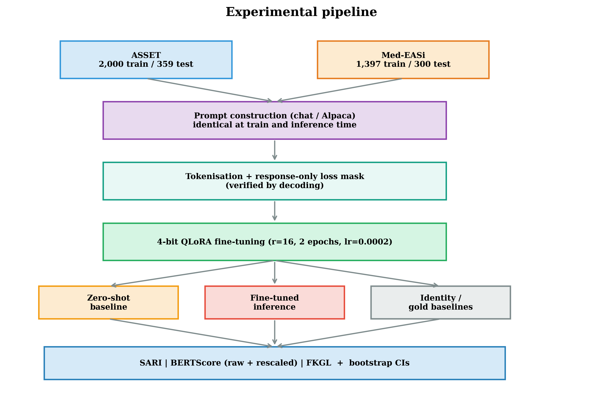

# Parameter-Efficient Fine-Tuning of Sub-2B Language Models for General and Biomedical Sentence Simplification

[](#citation)
[](#citation)
[](https://colab.research.google.com/github/ResearchSpirit/peft-llm-simplification/blob/main/final_notebook.ipynb)
[](LICENSE)

Code, LoRA adapters, predictions and evaluation results for the paper accepted at the
**1st International Conference on Computing and Digital Technology (ICoDiT 2026)**, track
Intelligent Systems & Artificial Intelligence.

**Stanley Nathanael Wijaya, Samuel Philip** · School of Computer Science, Bina Nusantara University, Indonesia

> 🏆 Presented onsite at BINUS @Alam Sutera on 19 November 2026 and received the **Best Presenter** award.

---

## TL;DR

Can open-weight language models **below 2B parameters** become good sentence simplifiers
with cheap 4-bit QLoRA adaptation on one 16 GB GPU? We adapted **Gemma-3 1B**, **Qwen3 1.7B**
and **DeepSeek-R1-Distill-Qwen 1.5B** under a single protocol on **ASSET** (general domain)
and **Med-EASi** (biomedical), and compared each fine-tuned model with its own zero-shot run.

- **It depends on the model.** On ASSET, Gemma-3 gained **+6.05 SARI** (95% CI [5.04, 7.09])
  and DeepSeek-Distill +1.53, but Qwen3 **lost 2.15 SARI** while still producing easier text (lower FKGL).
- **It depends on the domain.** Biomedical gains were smaller. Gemma-3's Med-EASi SARI gain
  (+2.35) is no longer significant once the 18 test sentences that also occur in training are removed.
- **It depends on the metric.** The `evaluate` SARI gives full deletion credit to outputs that
  delete nothing, so an unchanged copy of the input scores 53.78 on ASSET (20.45 under the
  original Xu et al., 2016 rule). We report both conventions.
- **It is cheap.** Adapters are 52–74 MB (1.0–1.3% of parameters), train in 11–21 min and
  peak at 1.7–3.2 GB of GPU memory, with 1.5–3.7 s inference per sentence on a T4.

<p align="center">
  
</p>

## Setup

| | |
|---|---|
| **Models** | [`google/gemma-3-1b-it`](https://huggingface.co/google/gemma-3-1b-it), [`Qwen/Qwen3-1.7B`](https://huggingface.co/Qwen/Qwen3-1.7B) (thinking mode off), [`deepseek-ai/DeepSeek-R1-Distill-Qwen-1.5B`](https://huggingface.co/deepseek-ai/DeepSeek-R1-Distill-Qwen-1.5B), loaded as Unsloth bnb 4-bit checkpoints |
| **Data** | [ASSET](https://huggingface.co/datasets/facebook/asset): train on `validation` (2,000 pairs), test on `test` (359 sources × 10 refs) · [Med-EASi](https://huggingface.co/datasets/cbasu/Med-EASi): train on `train` (1,397 pairs), test on `test` (300 sources × 1 ref) |
| **QLoRA** | NF4 + double quantisation, r = 16, α = 32, dropout 0, all attention and MLP projections, response-only loss |
| **Training** | AdamW-8bit, lr 2e-4, linear schedule, 3% warm-up, 2 epochs, effective batch 8, max 512 tokens, seed 42 |
| **Decoding** | greedy, repetition penalty 1.1, ≤ 256 new tokens; identical prompt for zero-shot and fine-tuned |
| **Metrics** | SARI (`evaluate` 0.4.6, plus Xu et al. 2016 convention), BERTScore F1 (roberta-large, layer 17), FKGL (`textstat`) |
| **Statistics** | 1,000-resample bootstrap CIs, one-sided paired bootstrap tests, Holm correction, train–test overlap sensitivity |
| **Hardware** | one NVIDIA T4 (15.6 GB), Google Colab, PyTorch 2.11 / CUDA 12.8 |

## Results

SARI with 95% bootstrap CI; BS = raw BERTScore F1. Higher is better except FKGL.

**ASSET** (n = 359)

| System | SARI ↑ | 95% CI | BS ↑ | FKGL ↓ |
|---|---:|:---:|---:|---:|
| Copy source (identity) | 53.78 | [53.42, 54.16] | 98.63 | 11.64 |
| Human reference (leave-one-out) | 43.47 | [42.59, 44.35] | 96.59 | 8.32 |
| Gemma-3 1B · zero-shot | 40.52 | [39.72, 41.27] | 83.99 | 11.91 |
| **Gemma-3 1B · fine-tuned** | **46.57** | [45.77, 47.44] | **97.54** | 8.75 |
| Qwen3 1.7B · zero-shot | 44.11 | [43.29, 44.98] | 96.57 | 9.37 |
| Qwen3 1.7B · fine-tuned | 41.96 | [41.08, 42.80] | 96.31 | **7.94** |
| DeepSeek-Distill 1.5B · zero-shot | 43.19 | [42.12, 44.21] | 92.08 | 11.18 |
| DeepSeek-Distill 1.5B · fine-tuned | 44.71 | [43.84, 45.57] | 97.02 | 8.50 |

**Med-EASi** (n = 300)

| System | SARI ↑ | 95% CI | BS ↑ | FKGL ↓ |
|---|---:|:---:|---:|---:|
| Copy source (identity) | 49.24 | [48.03, 50.47] | 92.04 | 13.64 |
| Gemma-3 1B · zero-shot | 37.93 | [36.59, 39.37] | 82.26 | 12.38 |
| **Gemma-3 1B · fine-tuned** | **40.27** | [38.55, 42.07] | 90.62 | 10.62 |
| Qwen3 1.7B · zero-shot | 38.36 | [36.85, 39.93] | **90.78** | 10.27 |
| Qwen3 1.7B · fine-tuned | 37.36 | [35.43, 39.30] | 88.89 | 10.54 |
| DeepSeek-Distill 1.5B · zero-shot | 37.83 | [36.43, 39.23] | 87.68 | 12.62 |
| DeepSeek-Distill 1.5B · fine-tuned | 37.09 | [35.26, 38.85] | 89.52 | **9.89** |

**Effect of fine-tuning** (fine-tuned − zero-shot, paired bootstrap; * = p < 0.05)

| Model | ASSET ΔSARI | ASSET ΔFKGL | Med-EASi ΔSARI | Med-EASi ΔFKGL |
|---|---:|---:|---:|---:|
| Gemma-3 1B | +6.05* | −3.16* | +2.35* (+1.25 without overlap, n.s.) | −1.76* |
| Qwen3 1.7B | −2.15 (CI [−3.11, −1.23]) | −1.42* | −0.99 | +0.27 |
| DeepSeek-Distill 1.5B | +1.53* | −2.68* | −0.74 | −2.73* |

Full tables (BERTScore deltas, SARI under both conventions, Holm-adjusted p-values, the n = 282
overlap-free subset) are in [`outputs/metrics/`](outputs/metrics) and [`outputs/tables/`](outputs/tables).
Prior-work scores (MUSS, LLaMA-3.1 70B, GPT-4o; Qiang et al., 2025) are quoted in the paper for
context only, since they come from a different implementation and prompt.

**Efficiency** (single T4, per fine-tuned system)

| Model | Trainable params | Adapter | Train time | Peak GPU | Latency / sentence |
|---|---:|---:|---:|---:|---:|
| Gemma-3 1B | 13.05 M (1.29%) | 52.2 MB | 14.5–20.6 min | 1.67–2.82 GB | 3.59–3.72 s |
| Qwen3 1.7B | 17.43 M (1.00%) | 69.8 MB | 11.0–15.5 min | 2.24–3.15 GB | 1.72–2.17 s |
| DeepSeek-Distill 1.5B | 18.46 M (1.03%) | 73.9 MB | 11.4–16.5 min | 2.29–3.03 GB | 1.53–1.60 s |

## Repository structure

```
.
├── final_notebook.ipynb    # the complete pipeline: data → training → inference → evaluation → figures
├── outputs/
│   ├── models/             # 6 LoRA adapters (<model>_<dataset>) with tokenizer and training stats
│   ├── predictions/        # raw outputs of all 12 systems (+ .meta.json provenance) and merged CSVs
│   ├── metrics/            # corpus and per-sentence scores, CIs, significance tests, SARI conventions,
│   │                       # editing behaviour, efficiency; paper_key_numbers.json = every number in the paper
│   ├── tables/             # paper tables as CSV and LaTeX
│   ├── figures/            # all figures as 300-dpi PNG and vector PDF
│   ├── configs/            # experiment/training config, dataset stats, environment, run provenance
│   └── requirements.txt    # package versions of the run that produced the results
├── CITATION.cff
└── LICENSE
```

## Reproducing the results

The notebook has two modes, set in Section 01c.

**1. Verify the published results (default, `FREEZE_RESULTS = True`, ~15–25 min on a T4).**
Nothing is retrained or regenerated. The notebook loads the saved predictions, re-scores
every system, checks each recomputed score against the published one, and rebuilds all
metrics, tables and figures. It stops with an explanation if anything is missing or does not match.

```bash
git clone https://github.com/ResearchSpirit/peft-llm-simplification.git
cd peft-llm-simplification        # ~0.5 GB on disk, the six adapters included
pip install -r outputs/requirements.txt --extra-index-url https://download.pytorch.org/whl/cu128
jupyter notebook final_notebook.ipynb    # then: Run All
```

On **Google Colab**, run the two clone lines above as `!git clone ...` and `%cd peft-llm-simplification`
in a first cell, and set `USE_DRIVE = False` in Section 01d so the notebook reads the cloned
`outputs/` folder instead of Google Drive. Section 00 installs the pinned packages. Without a GPU,
BERTScore is read back from the saved per-sentence scores, while SARI and FKGL are still recomputed.

**2. Repeat the whole experiment (`FREEZE_RESULTS = False`, ~7–9 GPU-hours on a T4).**
Retrains the six adapters and regenerates all predictions. Train one model family per Colab
session (`ONE_MODEL_PER_SESSION = True`); finished adapters are detected and skipped on restart.
Point `BASE_OUTPUT` to an empty folder so the published results are not overwritten.

Results were produced with Python 3.13, PyTorch 2.11.0+cu128, Transformers 5.5.0, PEFT 0.20.0,
Unsloth 2026.8.22, `evaluate` 0.4.6, `bert-score` 0.3.13 and `textstat` 0.7.13
(full record: [`outputs/configs/environment.json`](outputs/configs/environment.json)).

## Using an adapter

A minimal example with Transformers + PEFT (a CUDA GPU is needed for the 4-bit base model).
The notebook (Sections 04 and 07) has the exact prompt and decoding code used in the paper.

```python
import torch
from transformers import AutoModelForCausalLM, AutoTokenizer
from peft import PeftModel

adapter = "outputs/models/gemma3_asset"            # or gemma3_medeasi, qwen3_*, deepseek_*
base = "unsloth/gemma-3-1b-it-bnb-4bit"           # see base_model in the adapter's README.md

tokenizer = AutoTokenizer.from_pretrained(adapter)
model = AutoModelForCausalLM.from_pretrained(base, device_map="auto", torch_dtype=torch.float16)
model = PeftModel.from_pretrained(model, adapter).eval()

instruction = (
    "Please rewrite the following complex sentence in order to make it easier to understand "
    "by non-native speakers of English. You can do so by replacing complex words with simpler "
    "synonyms (i.e. paraphrasing), deleting unimportant information (i.e. compression), and/or "
    "splitting a long complex sentence into several simpler ones. The final simplified sentence "
    "needs to be grammatical, fluent, and retain the main ideas of its original counterpart "
    "without altering its meaning."
)
sentence = "The committee postponed its decision pending further consultation with stakeholders."

prompt = tokenizer.apply_chat_template(
    [{"role": "user", "content": f"{instruction}\n\n{sentence}"}],
    tokenize=False, add_generation_prompt=True,   # Qwen3: also pass enable_thinking=False
)
inputs = tokenizer(prompt, return_tensors="pt", add_special_tokens=False).to(model.device)
out = model.generate(**inputs, max_new_tokens=256, do_sample=False, repetition_penalty=1.1)
print(tokenizer.decode(out[0, inputs["input_ids"].shape[1]:], skip_special_tokens=True))
```

DeepSeek-Distill adapters were trained with an Alpaca-style prompt
(`### Instruction:` / `### Input:` / `### Response:`) instead of a chat template; see
`ALPACA_TEMPLATE` in the notebook.

## Limitations

Each adapter was trained once (seed 42) with one learning rate and rank, on two English corpora.
Evaluation is fully automatic: there is no human or factuality evaluation, so biomedical outputs
must not be used for patient-facing text without expert review. Med-EASi SARI comparisons are
sensitive to train–test overlap and to the SARI convention. See Sect. 4.5 of the paper.

## Citation

```bibtex
@inproceedings{wijaya2026peft,
  title     = {Parameter-Efficient Fine-Tuning of Sub-2B Language Models for General and Biomedical Sentence Simplification},
  author    = {Wijaya, Stanley Nathanael and Philip, Samuel},
  booktitle = {Proceedings of the 1st International Conference on Computing and Digital Technology (ICoDiT 2026)},
  publisher = {Springer Nature},
  year      = {2026}
}
```

Page numbers and DOI will be added once the proceedings are published.

## License

The code is released under the [MIT License](LICENSE). The adapters in `outputs/models/` are
subject to their base-model licenses ([Gemma Terms of Use](https://ai.google.dev/gemma/terms),
Apache 2.0 for Qwen3, MIT for DeepSeek-R1-Distill-Qwen). Files that contain dataset text
(predictions, per-sentence scores) remain under the licenses of
[ASSET](https://github.com/facebookresearch/asset) and
[Med-EASi](https://huggingface.co/datasets/cbasu/Med-EASi).
